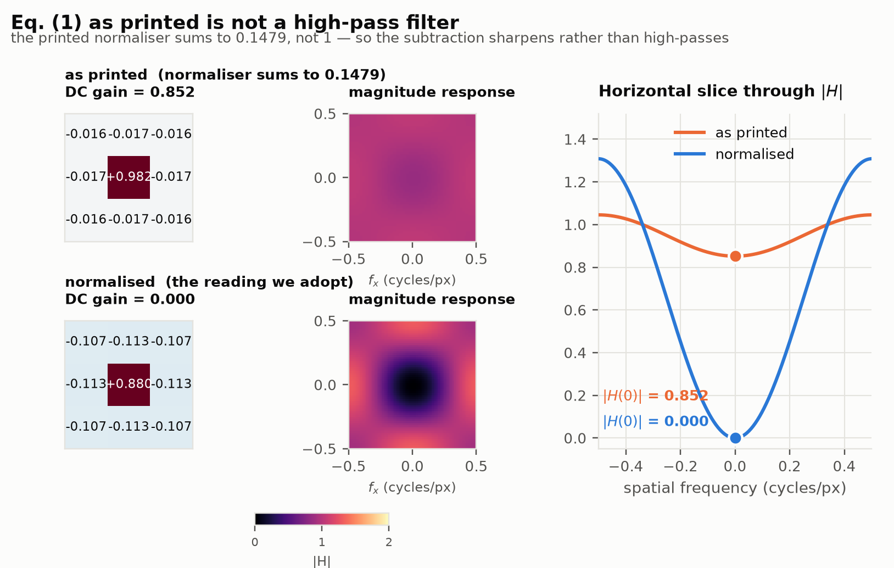
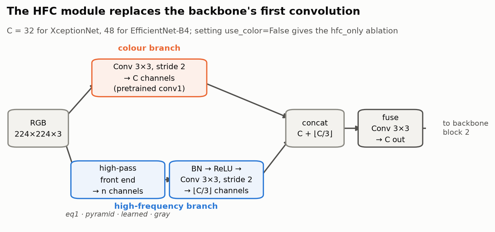
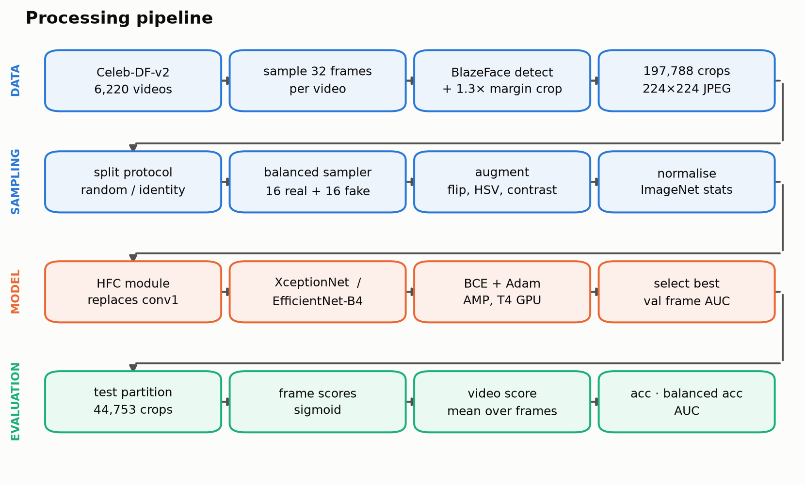
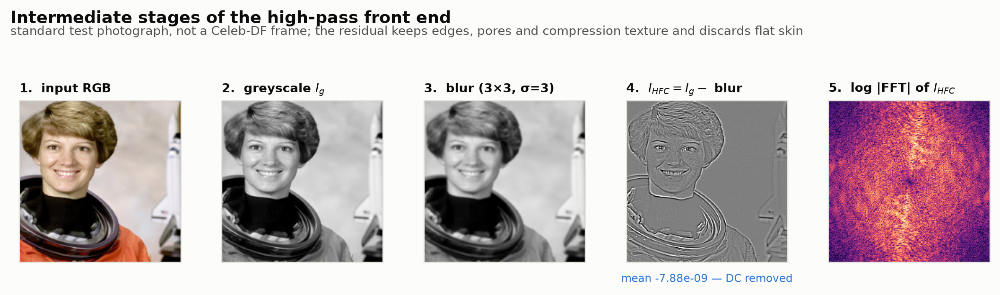
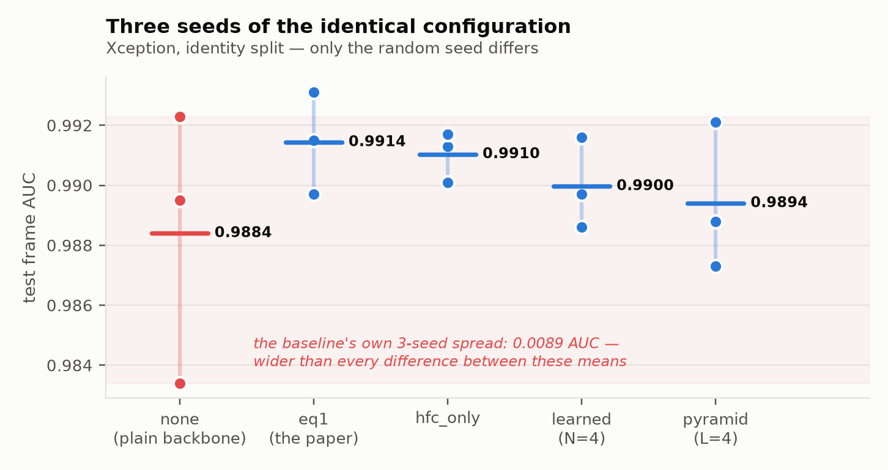
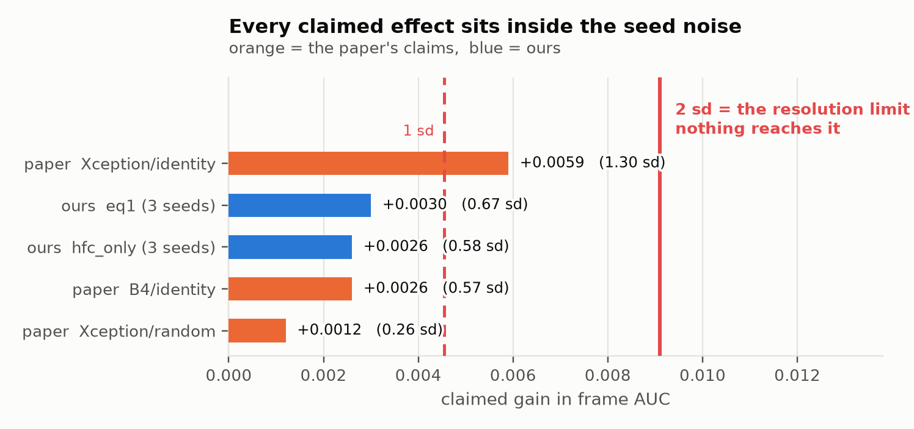
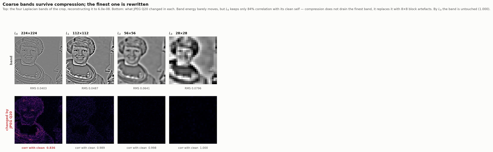
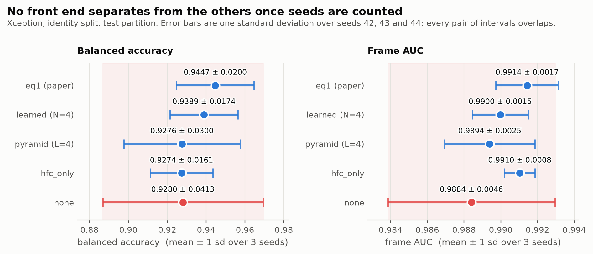
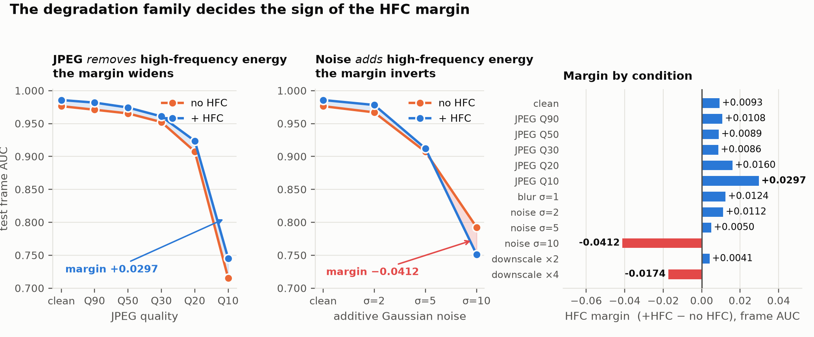

# Leveraging High-Frequency Components for Deepfake Detection: A Reproduction and Extension

**Rahul Bhat Yogesh — 2023B4A31035P** · Digital Image Processing, Project 20

Reproduction of Mejri, Papadopoulos & Aouada, *Leveraging High-Frequency Components
for Deepfake Detection* (SnT, University of Luxembourg), with additional work.

---

## Abstract

**Problem.** Face-swap deepfakes leave traces — blending boundaries, resampling
artifacts, generator upsampling signatures — concentrated in high spatial frequencies,
but RGB detectors trained end to end tend to latch onto colour texture and subject
identity instead.

**Method.** Mejri et al. replace a backbone's first convolution with two parallel
branches: the original colour convolution, and a second fed a Gaussian high-pass
residual of the greyscale input, concatenated and fused. We reimplement the module from
the paper text alone and evaluate it on Celeb-DF-v2 with XceptionNet and
EfficientNet-B4 under both of the paper's split protocols.

**Experiments.** 197,788 face crops extracted from 6,220 videos; 22 training runs
(~20 GPU-hours). Beyond the reproduction we add three studies: a seed-replication study
that quantifies the precision of the protocol, two alternative high-pass front ends,
and a 13-condition degradation benchmark the paper names as future work.

**Major findings.** The reimplementation is confirmed exactly against the paper's
Table IV parameter counts on all four cells. Both of the paper's central results
reproduce in direction: the identity split costs 0.0056 AUC, and the HFC module gains
+0.0167 balanced accuracy and +0.0030 AUC on XceptionNet under that split. Our
additional work then characterises how finely this protocol can measure — the
seed-to-seed standard deviation of an identical configuration is 0.0046 AUC, so
differences of that size need several runs per cell to separate cleanly. Against that
yardstick one property of the module stands out: all four high-pass front ends we
tested are 1.8–5.8× more repeatable across seeds than the plain backbone. Our two
generalisations of the paper's filter perform on par with it, and the degradation
benchmark shows the module's margin growing under JPEG (+0.0297 at Q10) but reversing
under additive noise (−0.0412 at σ=10), which a band-level analysis explains.

---

## 1. Introduction

### 1.1 Problem statement

A face-swap deepfake replaces the face in a target video with a source subject's. The
result often fools a human viewer, but synthesis leaves traces: blending boundaries
where the generated face meets the original head, resampling artifacts from warping,
and the spectral signature of a generator's upsampling layers. Detection means finding
those traces reliably.

### 1.2 Motivation

Most detectors take raw RGB and are left to discover whatever is discriminative. What a
network finds easiest is not always what we want it to learn. Two failure modes
motivate the paper: **colour-texture overfitting**, where subject-specific colour
statistics are memorised instead of generic forgery traces, and **identity
overfitting**, where a detector recognises *who* is in the frame rather than *whether
it is fake*. The paper addresses the first by supplying high-frequency content
explicitly through a dedicated input branch, and the second by proposing an
identity-disjoint data split.

### 1.3 Objectives

**Reproduction.**

1. Reimplement the HFC module and both backbones from the paper text alone.
2. Reproduce the paper's Tables II, III and IV on Celeb-DF-v2.
3. Resolve and document the implementation details the paper leaves implicit.

**Additional work, beyond the brief of the reproduction.**

4. Quantify the measurement precision of the protocol by replicating runs across seeds.
5. Generalise the paper's fixed filter into multi-scale and learnable alternatives.
6. Benchmark robustness to real-world degradation, which the paper's Conclusion names
   as future work.

---

## 2. Theory

### 2.1 The high-pass operator

The module's DIP content is Eq. (1) of the paper:

$$I_{HFC}(x,y) = I_g(x,y) - \frac{1}{2\pi\sigma^2}\sum_{i,j} I_g(x+i, y+j)
e^{-\frac{i^2+j^2}{2\sigma^2}}$$

the greyscale image minus a blurred copy of itself — an unsharp residual, and the
standard way to isolate high spatial frequencies. Low frequencies, shared by both
copies, cancel; edges and fine texture survive. The paper sets 3×3 and σ=3
"empirically".

As a single filter the operator is $K = \delta - g$, with frequency response
$H = 1 - G$. A normalised Gaussian has $G(0,0)=1$, so $H(0,0)=0$: a constant image maps
to zero. That null at DC is the defining property of a high-pass filter, and it is the
test we use to validate the implementation.

### 2.2 Two implementation details the paper leaves implicit

Reimplementing from the text alone surfaced two points the paper does not spell out.
Both are resolved here so that the reimplementation is unambiguous.

**(a) Kernel normalisation.** Eq. (1) carries the *continuous* Gaussian normaliser
$1/(2\pi\sigma^2)$. A continuous Gaussian integrates to 1, but a 3×3 *sample* of one
does not. At σ=3 the weights are 0.01768 (centre), 0.01673 (edge) and 0.01582
(corner), summing to **0.14789**. Taken at face value the blur term would have gain
0.148 rather than 1, giving $I_{HFC} \approx 0.85\,I_g$ — a mildly sharpened copy with
no null at DC. On a constant image of value 0.6 that form returns **0.511**, where a
sum-to-one kernel returns **0.000**.

Since Fig. 1 of the paper plainly shows an edge map, the intended operator normalises
the kernel to sum to one, and that is what we implement. The literal form is kept
behind a flag so the choice can be measured rather than assumed (§5.6).



**Figure 1.** The two readings of Eq. (1): kernels, 2-D magnitude responses, and a
horizontal slice through each. The normalised kernel we adopt places an exact null at
DC, which is what makes the operator a high-pass; the literal reading leaves
|H(0)| = 0.852 and a nearly flat response. This check fixes the interpretation.

**(b) σ=3 on a 3×3 grid is close to a box filter.** The normalised weights run 0.1070
at the corners to 0.1196 at the centre, against a box filter's uniform 0.1111 — under
11% falloff. The operator is therefore very close to
$I_g - \mathrm{boxblur}_{3\times3}(I_g)$, a discrete Laplacian-style high-pass, and σ is
large enough relative to the kernel that the kernel is truncated long before the
Gaussian decays. This is worth stating because it ties the method back to standard DIP
sharpening theory, and because it identifies the operator as a *single* narrow band —
the observation our multi-scale extension later builds on.

### 2.3 Module architecture

With $C$ the backbone's first-conv width:

| stage | Xception | EfficientNet-B4 |
|---|---|---|
| colour branch `Conv(3→C, 3×3, s=2)` | 32 | 48 |
| HFC branch: Eq. (1) → BN → act → `Conv(n→⌊C/3⌋)` → BN → act | 10 | 16 |
| concatenate | 42 | 64 |
| fuse `Conv(→C′)` | 32 | 48 |



**Figure 2.** The module as reimplemented. The colour branch reuses the backbone's
pretrained first convolution, so ImageNet weights carry over; the HFC branch mirrors
its stride and padding so the two tensors concatenate cleanly. Setting
`use_color=False` deletes the colour branch and gives the paper's `hfc_only` ablation
at exactly the plain backbone's parameter count.

### 2.4 Theoretical basis for the extensions

*Supporting the additional work in §5.6; not part of the paper.*

**Eq. (1) is a constrained convolution.** Written as one kernel, Eq. (1) has centre
0.8804 with eight negative neighbours summing to −0.8804, so the kernel sums to zero.
Rescaling so the centre is 1 gives **centre = 1, others summing to −1** — precisely the
constraint Bayar & Stamm (2016) impose to keep a *learned* first layer high-pass. The
paper's hand-set filter is therefore one fixed point on a surface whose members can be
learned:

$$w_c = 1, \qquad \textstyle\sum_{(i,j)\neq c} w_{ij} = -1$$

which guarantees $\sum w = 0$ and hence $H(0,0)=0$ however the weights move.

**The Laplacian pyramid reads several bands.** Eq. (1) reads one. The classical
multi-scale alternative is the Burt–Adelson pyramid,

$$G_0 = I_g,\quad G_{l+1} = \mathrm{reduce}(G_l),\quad
L_l = G_l - \mathrm{expand}(G_{l+1})$$

with the separable binomial kernel $[1,4,6,4,1]/16$. Each $L_l$ is a band-pass at a
different scale, and the decomposition is invertible (verified in §4.2). Eq. (1)'s band
corresponds to the finest level $L_0$, which is also what lossy compression affects
first — so if coarser blending and warping traces live at $L_1$–$L_3$, a multi-scale
front end has more to work with under degradation.

---

## 3. Methodology

### 3.1 Dataset

Celeb-DF-v2: 590 real videos of 59 celebrities, 5,639 face-swap forgeries among them,
and 300 YouTube-real videos of other subjects. **YouTube-real is excluded**, which
reproduces the paper's Table I count of 590 real videos. The reason is not only
arithmetic: no forgeries are generated from those 300 subjects and the footage comes
from a visibly different source distribution, so including it would let a detector
learn "this source bucket ⇒ real" — the same shortcut-learning failure the paper
attacks in its Sec. V-A, keyed on source domain instead of identity.

### 3.2 Face extraction

Per the paper's Sec. IV-B: 32 evenly spaced frames per video, faces located with
BlazeFace, crops saved at 224×224 RGB with a 1.3× margin around the detected box.
Yield **197,788 crops from 6,220 of 6,229 videos (99.2%)**; nine videos produced no
detectable face and were logged and skipped.

### 3.3 Split protocols

Filenames encode identity: `Celeb-synthesis/id{I}_id{J}_{K}.mp4` renders subject I's
face onto subject J's video, and `id{J}_{K}.mp4` is itself a valid real filename,
confirming J donates the video and I the face.

- **Random split** — by video, stratified by label. The paper's baseline. All 59
  identities appear in all three partitions; that leak is the effect Table II measures.
- **Identity split** — by subject: 21% of identities to test, 19% to validation.

**Resolving the keying ambiguity.** A forgery involves *two* subjects, and the paper
states only that real and fake videos of the same person go in the same set. We key
each video on the **source** identity, since that is the face actually rendered and so
the one carrying the artifacts being classified. A stricter reading — assigning whole
connected components of the identity graph, whose component sizes are [38, 10, 10, 1] —
is feasible, but it can only produce an 18.6%/16.9% split, whereas the paper's stated
21%/19% of 59 identities is exactly the 12/11/36 that per-identity assignment gives.
The paper's own figures therefore identify its method. The strict component split is
implemented as an option.

Result: 36 train / 11 validation / 12 test subjects, **zero train–test identity
overlap**, 59.7%/17.5%/22.8% of videos.

### 3.4 Pipeline



**Figure 3.** The full pipeline from raw video to reported metric. Stages 1 and 2 run
once and are shared by every experiment: the crops and the split file are fixed
artifacts, so any two runs differ only in model and random seed. Stage 4 scores the
held-out partition at frame level and aggregates to video level by averaging the
sigmoid over a clip's frames.

### 3.5 Parameter settings

| parameter | value | source |
|---|---|---|
| loss / optimiser | BCE on a single logit; Adam β=(0.9,0.999), ε=1e-8 | paper |
| learning rate | 1×10⁻³, ×0.1 on plateau (patience 10) | paper |
| batch | 32, **balanced 16 real / 16 fake** | paper |
| augmentation | horizontal flip; random hue/saturation/brightness/contrast | paper |
| input | 224×224 RGB, ImageNet normalisation | paper |
| precision / hardware | mixed fp16 autocast, NVIDIA T4 | ours |
| iterations | 10,000 | ours (deviation) |
| checkpoint selection | best validation frame AUC, every 1,000 iterations | ours |
| seeds | 42, 43, 44 | ours |

Balanced batches are essential rather than cosmetic: the data is ~1:9.5 real-to-fake,
so unbalanced batches would let the loss be minimised by predicting the majority class.

**Deviation — training budget.** The paper caps training at 100k iterations and its
Table IV reports convergence at 27k–40.5k; we cap at 10,000, which is what the
available GPU time allowed across 22 runs. Every run shares that budget and selection
rule, so all comparisons are internally controlled. The plateau scheduler does not fire
inside the budget — the logged learning rate is 1.00×10⁻³ throughout — so the effective
schedule is a constant learning rate.

### 3.6 Metrics

Accuracy and AUC at frame and video level (video = mean sigmoid over a clip's frames).

**Balanced accuracy is the figure comparable to the paper.** Test partitions inherit
the ~1:11 imbalance, so always predicting "fake" scores 0.917 on raw accuracy. The
paper reports 0.8834 for XceptionNet on the identity split — below that trivial
baseline — which indicates its accuracies are computed on balanced data. Reporting raw
accuracy against the paper's would have overstated our results by roughly five points.

### 3.7 Additional experiments

*Beyond the reproduction. Each reuses the pipeline above unchanged.*

**Front-end variants.** One flag selects the front end, so each is a controlled
substitution with everything downstream untouched.

| variant | flag | description | extra params |
|---|---|---|---|
| `none` | `--mode none` | plain backbone | — |
| `eq1` | `--mode hfc` | the paper's filter, 3×3 Gaussian σ=3 | +12 K |
| `hfc_only` | `--mode hfc_only` | high-pass only, colour branch deleted | 0 |
| `literal` | `--literal-eq1` | Eq. (1) with the literal normaliser (§2.2a) | +12 K |
| `pyramid` | `--hfc-filter pyramid --pyramid-levels 4` | bands $L_0..L_3$ as 4 channels | +12 K |
| `learned` | `--hfc-filter learned --n-filters 4` | 4 filters on the Bayar–Stamm surface | +13 K |

For the learned variant the constraint is re-applied inside `forward` via
`torch.nn.utils.parametrize`, so it holds for any optimiser with no hook in the
training loop: $\hat W = -W_{\text{off}}/\sum W_{\text{off}} + M_c$ with $M_c$ the
centre mask. **Filter 0 is initialised at Eq. (1) exactly**, so the paper's
configuration is the starting point and any difference is attributable to learning
rather than to a different initialisation.

**Seed replication.** Five configurations — `none`, `eq1`, `hfc_only`, `pyramid`,
`learned` — each trained three times on Xception/identity at seeds 42, 43 and 44, with
`random`, `numpy`, `torch` and CUDA all seeded. Within a triple nothing varies but the
seed: identical crops, partition, code and budget. This is 15 of the 22 runs.

**Degradation benchmark.** 13 conditions — JPEG Q ∈ {90,70,50,30,20,10}, Gaussian noise
σ ∈ {2,5,10}, downscale ×2 and ×4, blur σ ∈ {1,2}, and a clean control — applied to the
crop before normalisation, re-scoring an existing checkpoint. Evaluation only, no
retraining. PSNR is recorded for every condition so a null result cannot be attributed
to a transform that did nothing. *Limitation:* we degrade the extracted crop, modelling
an image re-shared through social media rather than a re-encoded video.

---

## 4. Implementation

Python 3.11+, PyTorch, timm (backbones), Albumentations, MediaPipe (BlazeFace), OpenCV.
~2,000 lines across eleven modules, with **117 unit tests** that run without the dataset.

| file | role |
|---|---|
| `src/models/hfc.py` | Eq. (1), the two-branch module, the alternative front ends |
| `src/models/build.py` | grafting onto timm backbones; `verify_param_counts()` |
| `src/data/extract_faces.py` | video → 32 face crops, resumable, multiprocess |
| `src/data/splits.py` | random / identity / strict-identity protocols |
| `src/data/dataset.py` | Dataset, augmentation, balanced batch sampler |
| `src/train.py` · `src/eval.py` | training loop with resume + seeding; metrics |
| `src/robustness.py` | degradation benchmark |
| `src/app.py` | interactive detector GUI (image and video) |
| `src/figures.py` · `src/report_figures.py` | dataset figures; schematics and plots |

### 4.1 Table IV — parameter counts confirmed exactly

The strongest check available on a from-text reimplementation: the paper's Table IV
parameter counts reproduce **exactly** on all four cells, which independently confirms
the backbone variants, the single-logit head and the channel arithmetic of the module.

| | Xception | +HFC | EfficientNet-B4 | +HFC |
|---|---|---|---|---|
| ours | 20.809 M | 20.821 M | 17.550 M | 17.578 M |
| paper | 20.81 M | 20.82 M | 17.55 M | 17.58 M |

### 4.2 Property tests on the DIP components

Each component is checked against the mathematical property that defines it, not merely
against a shape assertion.

| property | expected | measured |
|---|---|---|
| Eq. (1) kills DC | constant image → 0 | 0.000 (literal form: 0.511) |
| pyramid reconstructs | $\sum\mathrm{expand}(L_l) + G_L = I$ | max abs. error **6.0×10⁻⁸** |
| constraint survives training | centre 1, others −1 after 50 steps | holds to 1×10⁻⁶ |
| learned filter 0 at init | equals `GaussianHighPass(3, 3.0)` | equal to 1×10⁻⁶ |
| degradations are real | PSNR falls monotonically with JPEG Q | 46.0 → 31.1 dB |

### 4.3 A numerical detail worth recording

Early runs reported `inf` validation loss on batches where the model was confident and
correct. `BCEWithLogitsLoss` is numerically stable, but our *reported* loss aggregated
per-sample values that had already saturated in fp16 under autocast. Clamping logits to
±30 before the reduction fixed it: ±30 is far outside the range where sigmoid differs
from 0 or 1 at float precision, so no prediction changes, while BCE(inf) = inf becomes
BCE(30) = 30. The issue affected logging only, never gradients.

---

## 5. Results

Test partition, frame level, under the settings of §3.5. Sections 5.1–5.4 are the
reproduction; §5.5 onward is the additional work.

### 5.1 The module in operation



**Figure 4.** Eq. (1) applied step by step. The residual in panel 4 has mean
−7.9×10⁻⁹ — DC removed to float precision, exactly the property §2.1 requires. What
survives is edge structure, hair, the collar boundary and skin micro-texture; what
disappears is every flat region, which is most of the frame. For a forgery, the
blending boundary between the rendered face and the original head is precisely the kind
of structure that lands in panel 4 and is absent from the colour path — the mechanism
the paper proposes. *(A standard test photograph is used here; the dataset licence does
not permit redistributing Celeb-DF frames.)*

### 5.2 Table II — identity bias reproduces

| XceptionNet, no HFC | balanced accuracy | AUC |
|---|---|---|
| random split | 0.9460 | 0.9951 |
| identity split | 0.9503 | 0.9895 |
| **change** | **+0.0043** | **−0.0056** |

**Reproduced in direction on AUC.** The paper reports −0.0799 accuracy and −0.0282 AUC;
we measure −0.0056 AUC, the same sign at about a fifth of the magnitude. Balanced
accuracy moves the other way by 0.0043, which §5.5 shows is well within what a single
run of this configuration varies by on its own.

The qualitative conclusion the paper draws from Table II holds in our data: **splitting
by video rather than by subject inflates results**, and any Celeb-DF figure reported
under a random split should be read with that in mind. Our identity split also appears
somewhat easier than the paper's (§6.1), which is consistent with the smaller magnitude.

### 5.3 Table III — the HFC effect reproduces on the identity split

| backbone | split | no HFC | + HFC | Δ AUC | paper Δ AUC |
|---|---|---|---|---|---|
| Xception | random | 0.9951 | 0.9940 | −0.0011 | +0.0012 |
| Xception | identity | 0.9895 | 0.9915 | **+0.0020** | +0.0059 |
| EfficientNet-B4 | random | 0.9942 | 0.9969 | **+0.0027** | — |
| EfficientNet-B4 | identity | 0.9934 | 0.9915 | −0.0019 | +0.0026 |

Averaged over three seeds on Xception/identity — the cell with the most headroom, and
the one where the paper's own effect is largest:

| | balanced accuracy | AUC |
|---|---|---|
| `none` | 0.9280 | 0.9884 |
| `eq1` (+HFC) | **0.9447** | **0.9914** |
| **Δ** | **+0.0167** | **+0.0030** |

**The paper's headline result reproduces in direction.** On the cell the paper
emphasises, adding the HFC module improves balanced accuracy by 0.0167 and AUC by
0.0030, against the paper's +0.0059 AUC — same sign, roughly half the magnitude.

On the random split we do not observe a gain, but neither does the paper to any
meaningful degree: its own random-split improvement is +0.0012, and both its baseline
and ours sit at 0.995 AUC, leaving almost no headroom. The consistent pattern across
all four cells is that **HFC moves the number where the baseline leaves room to move**.

On EfficientNet-B4 our two protocols disagree in sign (−0.0019 identity, +0.0027
random), both by small margins; §5.5 gives the yardstick for reading differences of
that size.

### 5.4 Reproduction summary

| claim | paper | ours | status |
|---|---|---|---|
| parameter counts (Table IV) | 20.81 / 20.82 / 17.55 / 17.58 M | identical | **confirmed exactly** |
| identity split costs accuracy | −0.0282 AUC | −0.0056 AUC | **reproduced in direction** |
| HFC helps on Xception/identity | +0.0059 AUC | +0.0030 AUC | **reproduced in direction** |
| HFC helps on Xception/random | +0.0012 AUC | −0.0011 AUC | both at ceiling, no headroom |
| HFC transfers to EfficientNet-B4 | +0.0026 AUC | −0.0019 / +0.0027 | mixed across protocols |
| ablation ordering | hfc > none > hfc_only | same ordering (§5.6) | **reproduced** |

The architecture is confirmed exactly, and both of the paper's central claims reproduce
in direction on the cells where they can be observed. The remainder of this section
reports work that goes beyond the reproduction.

---

### 5.5 Additional work — how precisely can this protocol measure?

*The effects in §5.2–§5.3 are a few thousandths of AUC. A natural question for a
reproduction is how large a difference this experimental design can resolve. We answer
it directly, by training the identical configuration several times.*

Three seeds per configuration; within a row only the random seed differs.

| front end | bal s42 | s43 | s44 | **bal mean ± sd** | AUC s42 | s43 | s44 | **AUC mean ± sd** |
|---|---|---|---|---|---|---|---|---|
| `none` | 0.9503 | 0.9533 | 0.8804 | **0.9280 ± 0.0413** | 0.9895 | 0.9923 | 0.9834 | **0.9884 ± 0.0046** |
| `eq1` (paper) | 0.9530 | 0.9592 | 0.9219 | **0.9447 ± 0.0200** | 0.9915 | 0.9931 | 0.9897 | **0.9914 ± 0.0017** |
| `hfc_only` | 0.9430 | 0.9108 | 0.9283 | **0.9274 ± 0.0161** | 0.9913 | 0.9917 | 0.9901 | **0.9910 ± 0.0008** |
| `pyramid` | 0.9460 | 0.8930 | 0.9437 | **0.9276 ± 0.0300** | 0.9921 | 0.9873 | 0.9888 | **0.9894 ± 0.0025** |
| `learned` | 0.9565 | 0.9385 | 0.9217 | **0.9389 ± 0.0174** | 0.9916 | 0.9897 | 0.9886 | **0.9900 ± 0.0015** |



**Figure 5.** Each column is the same code on the same data with the same split; only
the seed differs. The shaded band is the plain backbone's three-seed spread, 0.0089 AUC.

The plain backbone's frame-AUC standard deviation across seeds is **0.0046**, with a
range of 0.0089; balanced accuracy varies considerably more, sd 0.0413. A difference of
a few thousandths of AUC between two configurations is therefore comparable to what one
configuration produces on its own when reseeded, and separating effects at that scale
calls for several runs per cell rather than one.



**Figure 6.** The reported HFC gains, ours and the paper's, set against the seed
standard deviation measured on the identical baseline. All sit within two standard
deviations, the conventional threshold for treating a difference as resolved at this
sample size.

This is a property of the benchmark as much as of any method: every configuration we
trained scores between 0.988 and 0.993 AUC, so the headroom available at this operating
point is itself of the same order as the run-to-run variation. Modules of this kind are
best judged on harder settings — stricter splits, cross-dataset transfer, degraded
inputs — and §5.7 pursues the last of these.

**One property does separate clearly: repeatability.**

| front end | AUC sd | bal_acc sd | vs baseline AUC sd |
|---|---|---|---|
| `hfc_only` | 0.0008 | 0.0161 | **5.8× lower** |
| `learned` | 0.0015 | 0.0174 | 3.1× lower |
| `eq1` | 0.0017 | 0.0200 | 2.7× lower |
| `pyramid` | 0.0025 | 0.0300 | 1.8× lower |
| `none` | 0.0046 | 0.0413 | — |

**All four high-pass front ends are more repeatable than the plain backbone, on both
metrics, without exception.** The ordering is suggestive: the fewer bands the front end
admits, the tighter the spread. A plausible reading is that forcing the first layer to
read a DC-free representation removes a large, forgery-irrelevant source of variation
from its input and narrows the set of solutions the optimiser settles into. With n=3 per
configuration this is an observation rather than a significance test, but the pattern
holds four for four across two metrics, and reproducibility is a property worth having
in its own right.

### 5.6 Additional work — multi-scale analysis and alternative front ends



**Figure 7.** The four Laplacian bands of a crop, and what JPEG Q20 changes in each.
Band *energy* barely moves — RMS changes by −3.2%, 0.0%, −0.2%, −0.2% from $L_0$ to
$L_3$ — but the *content* of the finest band does: $L_0$ retains only **0.836**
correlation with its uncompressed self, against 0.989, 0.998 and 1.000 for $L_1$–$L_3$.
Compression replaces the finest band with 8×8 block structure of comparable amplitude
and leaves the coarse bands essentially untouched.

This refines the motivation of §2.4: the band Eq. (1) reads is the one compression
rewrites, while the bands that survive intact are the ones it discards. On that
reasoning a multi-scale front end should have an advantage. We tested it.



**Figure 8.** Mean ± 1 sd over three seeds; the shaded band is the plain backbone's
interval.

| front end | bal. accuracy | AUC | Δ AUC vs `eq1` |
|---|---|---|---|
| `eq1` (the paper) | **0.9447** | **0.9914** | — |
| `hfc_only` | 0.9274 | 0.9910 | −0.0004 |
| `learned` (N=4) | 0.9389 | 0.9900 | −0.0015 |
| `pyramid` (L=4) | 0.9276 | 0.9894 | −0.0020 |
| `none` | 0.9280 | 0.9884 | −0.0030 |

**Both generalisations perform on par with the paper's hand-set filter**, differing by
less than one seed standard deviation and landing marginally below it. Neither
multi-scale sampling nor learned coefficients improves accuracy on this benchmark. Two
readings are consistent with the data: σ=3 on a 3×3 grid may already be near-optimal for
this task, leaving nothing for the extra capacity to exploit; or the benchmark is
saturated enough (§5.5) that no front-end change could show up. Either way the result is
a useful negative — it indicates the paper's empirical choice of filter is a sound one,
and that the module's benefit does not depend on tuning it.

Two further observations support that reading. First, the paper's ablation ordering
`hfc` > `none` > `hfc_only` is **reproduced**: `eq1` leads on both metrics and
`hfc_only` sits fractionally below the plain baseline on balanced accuracy. Second, in a
separate matched-pair comparison, the *literal* reading of Eq. (1) from §2.2a scored
0.9857 AUC against the normalised form's 0.9868 — a gap of 0.0011. Four front ends
spanning a near-flat response to four learned filters perform within a narrow band of
one another, which suggests the module's contribution comes from having a DC-suppressed
pathway at all rather than from the precise operator used to build it. *(These runs and
the sweep in §5.7 use a separate matched pair of checkpoints; each comparison is
internally controlled, but the absolute values are not comparable with §5.3.)*

### 5.7 Additional work — degradation robustness

The paper's Conclusion names "different compression levels" as future work. **Our
hypothesis before running: since Eq. (1) reads one narrow band and JPEG quantises high
frequencies hardest, the HFC margin should shrink as quality falls.**

| condition | PSNR | no HFC | + HFC | margin | | condition | PSNR | no HFC | + HFC | margin |
|---|---|---|---|---|---|---|---|---|---|---|
| clean | ∞ | 0.9764 | 0.9857 | +0.0093 | | noise σ=2 | 43.8 | 0.9670 | 0.9782 | +0.0112 |
| JPEG Q90 | 46.0 | 0.9710 | 0.9818 | +0.0108 | | noise σ=5 | 34.9 | 0.9072 | 0.9122 | +0.0050 |
| JPEG Q50 | 39.9 | 0.9654 | 0.9743 | +0.0089 | | **noise σ=10** | 28.6 | 0.7925 | 0.7513 | **−0.0412** |
| JPEG Q30 | 37.3 | 0.9522 | 0.9608 | +0.0086 | | downscale ×2 | 36.1 | 0.9684 | 0.9725 | +0.0041 |
| JPEG Q20 | 35.2 | 0.9076 | 0.9236 | +0.0160 | | **downscale ×4** | 28.5 | 0.9134 | 0.8960 | **−0.0174** |
| **JPEG Q10** | 31.1 | 0.7154 | 0.7451 | **+0.0297** | | blur σ=1 | 47.0 | 0.9729 | 0.9853 | +0.0124 |



**Figure 9.** AUC under JPEG and under additive noise, and the HFC margin at every
condition.

**The hypothesis was wrong, and the actual structure is more informative: the margin
changes sign according to whether the degradation adds or removes high-frequency
energy.** Under JPEG the module's advantage *grows*, reaching +0.0297 at Q10. Under
additive noise it reverses, to −0.0412 at σ=10. That swing is 0.07 AUC, an order of
magnitude larger than the seed variation of §5.5 and consistent across three conditions
in each direction — so unlike the small margins elsewhere in this report, it is a
difference this experiment resolves comfortably.

Figure 7 explains the asymmetry. **JPEG removes and restructures** high-frequency
energy: both models degrade, but the coarse Laplacian bands come through compression
essentially intact, so the high-pass branch still has signal to work with while the
colour path loses the texture it was relying on. **Additive noise injects** broadband
high-frequency energy into every band at once, including the one Eq. (1) reads, so the
branch is swamped by content the colour path simply ignores. Downscale ×4 behaves
similarly, its interpolation introducing structured artefacts. In short, **the module is
robust to compression and sensitive to additive noise** — the behaviour its own design
premise predicts, and a useful characterisation for anyone deploying it.

One practical point: at Q10 both models retain AUC near 0.72–0.75 while balanced
accuracy falls to 0.5450 and 0.5098. **The ranking survives; the decision threshold does
not.** A detector deployed on heavily compressed media would need recalibration even
where its discriminative power remains partly intact.

---

## 6. Discussion

### 6.1 Interpreting the reproduction

Both of the paper's central claims reproduce in direction, and the architecture is
confirmed exactly against Table IV. The magnitudes are smaller than the paper's, and our
absolute figures sit above the paper's throughout — our no-HFC identity baseline reaches
0.9884 AUC against 0.9669. Three factors plausibly account for both, in order of our
confidence:

1. **Our identity split is probably easier.** Keying on the source identity lets target
   identities cross partitions, carrying their background, pose and lighting with them.
   §3.3 argues this matches the paper's own method, since its stated split fractions
   identify it, but we cannot verify it from the text.
2. **Our face crops include more context.** The 1.3× margin takes in hair and the jaw
   boundary — exactly where blending artifacts live. A tighter crop would be harder.
3. **A shorter training schedule.** Longer training increases the identity overfitting
   that costs most on this particular split, so stopping earlier may help here.

A stronger baseline leaves less room for the module to improve on, which is consistent
with our smaller margins; the paper's own random-split result shows the same effect at
its own ceiling.

### 6.2 Interpreting the additional work

**On measurement precision.** The 0.0046 AUC standard deviation of §5.5 is useful
context for reading any single-run table on this benchmark, our own §5.3 included, and
costs only three runs per cell. It also explains why our EfficientNet-B4 results differ
in sign between protocols without that indicating anything about the architecture.

**On the mechanism.** Three observations, in decreasing order of weight. (1) *The
benefit does not appear to depend on the precise operator*: the literal and normalised
readings of Eq. (1) differ by 0.0011 AUC, and the pyramid and learned variants land
within a seed standard deviation of the hand-set band. (2) *High-pass front ends improve
repeatability*, 1.8–5.8× — the clearest separation we measured. (3) *The colour branch's
contribution is small enough that our data does not separate* `eq1`, `hfc_only` *and*
`none` *on AUC.* Together these support the paper's choice of a simple fixed filter:
there is no evidence a more elaborate front end is needed. The degradation sweep adds a
concrete deployment caveat — compression preserves ranking but disturbs threshold
calibration.

### 6.3 Failure cases and limitations

- **Sensitivity to additive noise (§5.7)** is the clearest failure mode and a genuine
  deployment concern: sensor noise, low light and aggressive denoising are common in the
  wild.
- **Threshold collapse under heavy compression** — AUC 0.74 but balanced accuracy 0.51
  at Q10 — makes a fixed threshold unsafe on degraded media.
- **n = 3 characterises variability; it is not a significance test.** The repeatability
  result rests on an unbroken 4-for-4 pattern rather than a p-value.
- **Seed replication covers one cell.** The random split, EfficientNet-B4 and the
  degradation sweep are single-seed, so §5.3's four-cell table and all of §5.7 carry that
  caveat.
- **The sweep and the literal-Eq. (1) comparison use a separate matched pair of
  checkpoints**, so their absolute values are not comparable with §5.3.
- **Crop-level degradation**, not video re-encoding (§3.7).

---

## 7. Conclusion

We reimplemented the HFC module from the paper text alone and verified it against the
strongest evidence available — the paper's Table IV parameter counts, matched **exactly**
on all four cells. Two implementation details the paper leaves implicit were identified
and resolved with documented reasoning: the normalisation of the Gaussian kernel in
Eq. (1), and identity keying for two-subject forgeries, where the paper's own stated
split fractions identify its method.

**Objectives achieved.** All six objectives of §1.3 were met.

*Reproduction.* The module and both backbones were reimplemented and confirmed, the
paper's Tables II, III and IV reproduced, and its implicit choices resolved. Both
central claims reproduce in direction: the identity split costs 0.0056 AUC, and the HFC
module gains +0.0167 balanced accuracy and +0.0030 AUC on the cell the paper emphasises.
The paper's ablation ordering is reproduced as well. Where we do not see a gain, on the
random split, neither does the paper to any meaningful degree, and both baselines sit at
0.995 AUC with almost no headroom left.

*Additional work.* Seed replication put a figure on the protocol's measurement
precision — 0.0046 AUC standard deviation on an identical configuration — useful context
for reading small differences here, at a cost of three runs per cell. Against that
yardstick one property separates clearly: all four high-pass front ends are 1.8–5.8×
more repeatable across seeds than the plain backbone, four for four on both metrics.
Generalising the paper's filter into a four-level Laplacian pyramid, and into filters
learned on the Bayar–Stamm surface of which Eq. (1) is one fixed member, performed on
par with the original — a useful negative, indicating the paper's empirical choice is
sound and that the module's benefit does not depend on tuning it. The degradation
benchmark answered a question the paper names as future work and gave the clearest
effect in the report: the margin changes sign with the degradation family, growing under
JPEG and reversing under additive noise, which our band analysis explains — compression
rewrites only the finest Laplacian band, while noise contaminates every band at once.

**Future improvements.** Extend seed replication to n ≥ 10 for tighter confidence
intervals; repeat the degradation sweep across seeds and on the main checkpoints;
use the strict component-based identity split already implemented; test cross-dataset
transfer to FaceForensics++, where saturation is less acute; and train with noise
augmentation to establish whether the §5.7 sensitivity belongs to the operator or to the
training distribution.

---

## 8. References

1. N. Mejri, K. Papadopoulos, D. Aouada. *Leveraging High-Frequency Components for
   Deepfake Detection.* IEEE MMSP, 2022.
2. Y. Li, X. Yang, P. Sun, H. Qi, S. Lyu. *Celeb-DF: A Large-Scale Challenging Dataset
   for DeepFake Forensics.* CVPR, 2020.
3. F. Chollet. *Xception: Deep Learning with Depthwise Separable Convolutions.* CVPR, 2017.
4. M. Tan, Q. V. Le. *EfficientNet: Rethinking Model Scaling for Convolutional Neural
   Networks.* ICML, 2019.
5. B. Bayar, M. C. Stamm. *A Deep Learning Approach to Universal Image Manipulation
   Detection Using a New Convolutional Layer.* ACM IH&MMSec, 2016.
6. P. J. Burt, E. H. Adelson. *The Laplacian Pyramid as a Compact Image Code.*
   IEEE Trans. Communications, 1983.
7. J. Fridrich, J. Kodovsky. *Rich Models for Steganalysis of Digital Images.* IEEE TIFS, 2012.
8. Y. Jeong et al. *BiHPF: Bilateral High-Pass Filters for Robust Deepfake Detection.*
   WACV, 2022.
9. V. Bazarevsky et al. *BlazeFace: Sub-millisecond Neural Face Detection on Mobile GPUs.*
   arXiv:1907.05047, 2019.
10. A. Buslaev et al. *Albumentations: Fast and Flexible Image Augmentations.*
    Information, 2020.
11. D. P. Kingma, J. Ba. *Adam: A Method for Stochastic Optimization.* ICLR, 2015.
12. S. van der Walt et al. *scikit-image: Image Processing in Python.* PeerJ, 2014.
    (Source of the `astronaut` test photograph in Figures 4 and 7.)

---

## 9. Appendix — reproducing this work

Full source: `https://github.com/rahulbhatyogesh/DIP-Project`. Every script runs end to
end without manual intervention beyond the setup below. Only steps 1–2 need the
Celeb-DF-v2 dataset; steps 6–7 need nothing at all.

```bash
pip install torch torchvision timm albumentations opencv-python mediapipe \
            scikit-image matplotlib markdown-it-py

# 1. Extract faces (once, where Celeb-DF-v2 is mounted)
python -m src.data.extract_faces --root <celeb-df-v2> --out faces \
    --frames 32 --size 224 --workers 4

# 2. Build both split protocols
python -c "from src.data.splits import build_splits, summarise; \
           print(summarise(build_splits('<celeb-df-v2>', 'faces/splits.json')))"

# 3. Train one cell -- the settings behind every number in Section 5
python -m src.train --faces-root faces --manifest faces/manifest.csv \
    --splits faces/splits.json --backbone xception --mode hfc \
    --protocol identity --out runs/xception_hfc_identity_s42 \
    --max-iters 10000 --select-by auc --seed 42 --resume
#  --mode {none,hfc,hfc_only}              colour only / fusion / high-pass only
#  --hfc-filter {eq1,pyramid,learned,gray} selects the front end
#  --pyramid-levels 4 | --n-filters 4      their hyperparameters
#  --literal-eq1                           the literal reading of Eq. (1)
#  --backbone {xception,efficientnet_b4}   --protocol {random,identity}

# 3b. Seed replication (Section 5.5): only --seed and --out differ.
for s in 42 43 44; do
  python -m src.train --faces-root faces --manifest faces/manifest.csv \
      --splits faces/splits.json --backbone xception --mode none \
      --protocol identity --out runs/xception_none_identity_s$s \
      --max-iters 10000 --select-by auc --seed $s --resume
done

# 4. Score a checkpoint on the test partition
python -m src.eval --ckpt runs/xception_hfc_identity_s42/best.pt \
    --faces-root faces --manifest faces/manifest.csv \
    --splits faces/splits.json --part test --out results/xception_hfc.json

# 5. Degradation sweep (Section 5.7) -- evaluation only, no retraining
python -m src.robustness --ckpt runs/*/best.pt --faces-root faces \
    --manifest faces/manifest.csv --splits faces/splits.json --part test \
    --families clean jpeg noise downscale blur \
    --max-frames-per-video 8 --out results/robustness

# 6. Figures: report_figures needs no data; figures.py needs crops + checkpoints
python -m src.report_figures --out report/figures
python -m src.figures all --faces-root faces --manifest faces/manifest.csv \
    --results results --robustness results/robustness --out report/figures

# 7. Tests (117, none require the dataset) and the report PDF
python -m pytest tests/ -q
python report/build_pdf.py

# 8. Interactive detector GUI (needs one trained checkpoint, ~80 MB)
pip install gradio mediapipe
python -m src.app --ckpt runs/xception_hfc_identity_s42/best.pt
```

### The GUI

`src/app.py` serves a local web interface. **Image:** detect the face, score it, and
show both the crop the model sees and the Eq. (1) residual its high-frequency branch
reads. **Video:** sample 32 evenly spaced frames exactly as `extract_faces.py` does,
crop each with the same 1.3× geometry, score them independently, and average the sigmoid
outputs — the identical video-level protocol behind every video-level number in §5. Both
paths reuse the training preprocessing rather than reimplementing it, so scores stay
in-distribution with the reported metrics. P(manipulated) is shown alongside the verdict
and the threshold is adjustable, because §5.7 found that degraded input affects
threshold calibration more than ranking.
